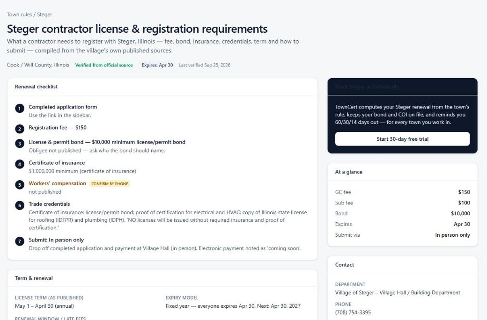
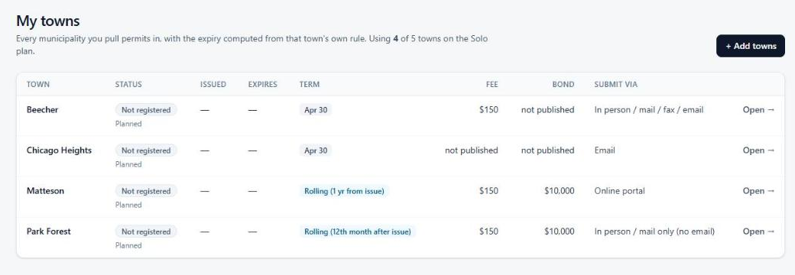

<p align="center">
  
</p>

<h1 align="center">TownCert</h1>

<p align="center">
  Municipal contractor-registration tracking for Chicago's south suburbs.<br />
  <strong><a href="https://towncert.com">towncert.com</a></strong> · live, taking customers
</p>

---

Every village around Chicago runs its own contractor registration: its own fee, bond, insurance minimums, expiration rule and way to submit. A plumber working Steger, Chicago Heights and Matteson has three different renewal dates computed three different ways, and the day one lapses, that village stops issuing permits. Contractors track this on whiteboards and in glove boxes.

TownCert replaces that. It holds the verified rules for **37 south-suburban jurisdictions**, computes each renewal from the town's actual rule, keeps the bond and certificate of insurance on file, and reminds the whole crew 60, 30 and 14 days out. It is a multi-tenant subscription SaaS that I designed, built and launched solo in 2026.

<p align="center">
  
</p>

<p align="center">
  
</p>

## What it does

- **Rules engine.** Three expiry models (fixed date, calendar year, rolling from issue), per-town checklists with fees, bonds, insurance minimums and forms, and a public page per jurisdiction that serves as both documentation and SEO landing page.
- **Reminders that match reality.** A 60/30/14/day-of ladder sent by daily cron, plus conflict detection when a COI or bond lapses in the 90 days before a renewal, the thing villages reject applications for.
- **Document vault.** COIs, bonds, state licenses and trade credentials stored privately and served through short-lived signed URLs.
- **Teams and billing.** Organizations with owner/admin/member roles, email invitations, a 30-day no-card trial, three plans through Stripe Checkout, plan switching through the customer portal, and a founding-customer offer whose remaining spots are read live from Stripe.
- **Operator console.** Rule editor with full revision history, customer-submitted corrections, verification tracking, customer list, and an email outbox.

## How it's built

| Layer | Choice |
|---|---|
| App | Next.js 16 (App Router, Server Actions), TypeScript, Tailwind CSS v4 |
| Data | PostgreSQL on Neon, Drizzle ORM; PGlite (embedded Postgres) locally and in tests |
| Auth | Clerk (email code + Google), with multi-tenancy implemented in the app |
| Billing | Stripe Checkout, Customer Portal and idempotent webhooks |
| Email & files | Resend (with a database outbox fallback), Cloudflare R2 behind signed URLs |
| Hosting | Vercel, with cron jobs for reminders and trial notices |
| Tests | Vitest (unit + integration against in-memory Postgres), Playwright (10 end-to-end flows) |

Every integration is optional at runtime: with zero keys the whole product runs locally on PGlite, local disk and a cookie-based dev login, and each piece switches to the real provider the moment its environment variable appears. That is what makes the test suite and local development frictionless.

## Run it locally

```bash
npm install --legacy-peer-deps
npm run seed:demo     # embedded Postgres + 37 jurisdictions + a demo company
npm run dev           # http://localhost:3000, sign in at /dev-login as demo@towncert.com
npm test              # unit + integration
```

Node 20.12 or newer. To see the operator console, start with `ADMIN_EMAILS=demo@towncert.com`. Production setup, service by service, is in [DEPLOY.md](DEPLOY.md).

## Where things live

```
data/jurisdictions.json     the rules database (37 towns, with sources and verification state)
src/lib/expiry.ts           expiry models and the reminder ladder (pure functions, unit-tested)
src/lib/reminders.ts        the daily reminder engine
src/lib/billing.ts          Stripe checkout, portal flows, webhook processing
src/lib/tenancy.ts          current user / organization / role resolution
src/db/schema.ts            the Postgres schema
src/app/                    routes: public site, onboarding, /app, /admin, /api
scripts/                    setup-stripe, founding-offer, check-env, seed, migrate
e2e/                        Playwright suites
```

## About the data

Rules were compiled from each municipality's website, application forms and codified ordinances in September 2026 and are re-verified on a schedule; the town pages cite their sources and flag anything a village doesn't publish. Requirements change without notice. The app says so on every page, and so does this README: confirm with the village before you submit.

## License

Source-available for review and reference. All rights reserved; see [LICENSE](LICENSE).
